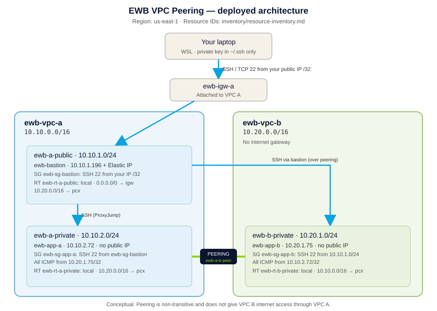

# EWB AWS VPC Peering Student Project

Two VPCs in `us-east-1` connected with VPC peering. Two private application servers exchange
traffic over their private IPv4 addresses, and a single public bastion host in VPC A is used
for administration. Built from the EWB Courses "AWS VPC Peering" student project workbook
(Project 01, AWS Architect Associate).

> Status legend used in this project:
> - **[PLANNED]** values from the EWB workbook design.
> - **[EXPECTED]** acceptance criteria from the workbook. They are not results.
> - **[ACTUAL]** values from the AWS console or real terminal output.
>
> Nothing is marked as passed without a recorded result.

## Cover details

| Field | Value |
|---|---|
| Student name | Sayantika Ghosh |
| Batch | Btech |
| Project title | AWS VPC Peering: Connect two VPCs, prove private connectivity |
| Region | `us-east-1` (US East, N. Virginia) |
| Completion date | 30-10-2026 |

## Deployed architecture [ACTUAL]



Full resource IDs: [`inventory/resource-inventory.md`](inventory/resource-inventory.md)

| Component | Name tag | Address | Notes |
|---|---|---|---|
| VPC A | ewb-vpc-a | 10.10.0.0/16 | Internet gateway `ewb-igw-a` attached |
| Public subnet A | ewb-a-public | 10.10.1.0/24 | Route table `ewb-rt-a-public` |
| Private subnet A | ewb-a-private | 10.10.2.0/24 | Route table `ewb-rt-a-private` |
| VPC B | ewb-vpc-b | 10.20.0.0/16 | No internet gateway |
| Private subnet B | ewb-b-private | 10.20.1.0/24 | Route table `ewb-rt-b-private` |
| Peering | ewb-a-b-peer | n/a | Requester VPC A, accepter VPC B |
| Bastion | ewb-bastion | 10.10.1.196 + Elastic IP | Amazon Linux 2023, t3.micro |
| App-A | ewb-app-a | 10.10.2.72 | No public IPv4 |
| App-B | ewb-app-b | 10.20.1.75 | No public IPv4 |

Private IPs were assigned by AWS, so they differ from the workbook's planned
`10.10.1.10`, `10.10.2.10` and `10.20.1.10`. All tests and security group sources use the
actual addresses above. No NAT gateway is used.

### Route tables

| Route table | Destination | Target | Verified by screenshot |
|---|---|---|---|
| ewb-rt-a-public | 10.10.0.0/16 · 0.0.0.0/0 · 10.20.0.0/16 | local · ewb-igw-a · ewb-a-b-peer | Yes, [`infrastructure/04`](evidence/screenshots/infrastructure/04-rt-a-public-routes-association.png) |
| ewb-rt-a-private | 10.10.0.0/16 · 10.20.0.0/16 | local · ewb-a-b-peer | Yes, [`infrastructure/05`](evidence/screenshots/infrastructure/05-rt-a-private-routes-association.png) |
| ewb-rt-b-private | 10.20.0.0/16 · 10.10.0.0/16 | local · ewb-a-b-peer | No screenshot. Tests 02 and 03 could not succeed without this return route. |

### Security groups, inbound [ACTUAL]

| Security group | Rule | Source | Evidence |
|---|---|---|---|
| ewb-sg-bastion | SSH 22 | Student public IPv4 /32 | [`security/01`](evidence/screenshots/security/01-sg-bastion-inbound-rules.png) (captured at launch; the group was edited later and its final rule set was not captured) |
| ewb-sg-app-a | SSH 22 · All ICMP IPv4 | ewb-sg-bastion security group · 10.20.1.75/32 (App-B) | [`security/02`](evidence/screenshots/security/02-sg-app-a-inbound-rules.png) |
| ewb-sg-app-b | SSH 22 · All ICMP IPv4 | 10.10.1.0/24 (public subnet A) · 10.10.2.72/32 (App-A) | [`security/03`](evidence/screenshots/security/03-sg-app-b-inbound-rules.png) |

The deployed rules are broader than the workbook's: All ICMP instead of ICMP Echo request,
a /24 SSH source on App-B instead of the bastion /32, and a security group reference
instead of a /32 on App-A. They still allow only the lab hosts or subnet, and nothing is open
to `0.0.0.0/0`.

## Forward and return path

- **Forward (App-A to App-B):** App-A `10.10.2.72` uses `ewb-rt-a-private`, where
  `10.20.0.0/16` points to the peering connection. The packet reaches App-B `10.20.1.75`,
  and `ewb-sg-app-b` allows ICMP from `10.10.2.72/32`.
- **Return (App-B to App-A):** App-B's reply uses `ewb-rt-b-private`, where `10.10.0.0/16`
  points to the same peering connection. Security groups are stateful, so the reply is allowed
  automatically, but the return route must exist.
- **Administration:** laptop (WSL) > bastion > App-B with SSH ProxyJump. `ewb-rt-a-public`
  needs `10.20.0.0/16` to the peering connection, and App-B sees the bastion's private IP
  (`10.10.1.196`) as the SSH source.

Peering is non-transitive and does not give VPC B internet access through VPC A. More detail:
[`docs/01-architecture.md`](docs/01-architecture.md).

## Test results [ACTUAL]

Full table and notes: [`evidence/test-results.md`](evidence/test-results.md)

| Test | Result | Evidence |
|---|---|---|
| 01 Baseline before peering | **Not recorded** | None |
| 02 Forward path: App-A to App-B ping | PASS, 0% packet loss | [`ewb-test-03.txt`](evidence/terminal-output/ewb-test-03.txt) (file names swapped, see notes), [`test-02-03`](evidence/screenshots/tests/test-02-03-ping-forward-and-reverse.png) |
| 03 Reverse path: App-B to App-A ping | PASS, 0% packet loss | [`ewb-test-02.txt`](evidence/terminal-output/ewb-test-02.txt), [`test-02-03`](evidence/screenshots/tests/test-02-03-ping-forward-and-reverse.png) |
| 04 SSH from WSL to App-B through the bastion (ProxyJump) | PASS | [`ewb-test-04.txt`](evidence/terminal-output/ewb-test-04.txt), [`test-04-wsl`](evidence/screenshots/tests/test-04-wsl-proxyjump-ssh-app-b.png) |
| 05 No public IPv4 on App-A or App-B | PASS | [`infrastructure/07`](evidence/screenshots/infrastructure/07-ec2-app-a-details-no-public-ip.png), [`infrastructure/08`](evidence/screenshots/infrastructure/08-ec2-app-b-details-no-public-ip.png) |
| F1 Remove the App-B ICMP rule | Done | [`test-f1`](evidence/screenshots/tests/test-f1-app-b-icmp-rule-removed.png) |
| F2 Ping App-A to App-B after removal | Failed as expected, 100% packet loss | [`ewb-f1.txt`](evidence/terminal-output/ewb-f1.txt), [`test-f2`](evidence/screenshots/tests/test-f2-ping-blocked-after-rule-removal.png) |
| F3 Restore the App-B ICMP rule | Done (no screenshot) | None |
| F4 Ping App-A to App-B after restoring | PASS, 0% packet loss (recovered) | [`ewb-f4.txt`](evidence/terminal-output/ewb-f4.txt) |

**Controlled failure explanation:** with the App-B ICMP rule removed, App-B's security group
dropped App-A's echo requests, so the ping got no replies even though the peering connection
and routes were unchanged. Restoring the rule let the replies return. This shows that an
active peering connection and correct routes are not enough on their own: the destination
security group must also allow the traffic.

## Deviations from the workbook

These are recorded as deployed, not corrected after the fact. Details are in the
[inventory](inventory/resource-inventory.md#deviations-from-the-workbook-actual).

1. Region `us-east-1` instead of the example `ap-south-1`. The new account could launch EC2
   only in US Regions at the time, so the build moved to `us-east-1`.
2. AWS-assigned private IPs instead of the planned `.10` addresses.
3. Key pair named `ewb-lab-key-us` instead of `ewb-lab`.
4. Broader security group rules (see the table above).
5. App-B is in `us-east-1b`, while the VPC A subnets are in `us-east-1a`. The workbook's
   same-AZ note applies to the VPC A subnets.
6. **Private key on the bastion.** The workbook says never to copy the private key to an
   instance. During early testing the key was copied to the bastion and used for SSH from the
   bastion to App-A and App-B. It was then deleted from the bastion
   ([`security/04`](evidence/screenshots/security/04-bastion-private-key-removed.png)), and
   test 04 was run from the laptop with ProxyJump as the workbook intends.
7. The bastion uses an Elastic IP (`52.54.130.241`) rather than an auto-assigned public IPv4.

## Evidence not captured

- Test 01 baseline (no replies before peering).
- Peering connection in **Active** state with both VPC IDs (only the request in Pending
  acceptance was captured; the `ewb-rt-a-private` screenshot shows the pcx route as Active).
- `ewb-vpc-b`, `ewb-b-private` and `ewb-rt-b-private` (routes and association).
- Final `ewb-sg-bastion` rule set; F3 rule restore; F4 screenshot.
- Cleanup evidence (cleanup has not been performed yet).

## Repository structure

```
.
├── README.md
├── .gitignore
├── cleanup/
│   ├── cleanup-checklist.md
│   └── screenshots/              cleanup evidence (to be added after cleanup)
├── config/
│   └── ssh-config.example        SSH ProxyJump template, placeholder bastion IP
├── diagrams/
│   └── architecture.svg          deployed architecture
├── docs/
│   ├── 01-architecture.md        design, CIDR rationale, forward and return path
│   ├── 02-build-runbook.md       console build steps with deployed values
│   ├── 03-test-plan.md           tests 01 to 05 and controlled failure: expected vs evidence
│   ├── 04-troubleshooting.md     symptom checks and issues met during the lab
│   └── 05-viva-notes.md          answers to the workbook's viva questions
├── evidence/
│   ├── test-results.md           pass/fail summary
│   ├── terminal-output/          raw terminal output
│   └── screenshots/
│       ├── infrastructure/       VPC, subnet, IGW, route tables, peering, instances, Elastic IP
│       ├── security/             security group rules, key removed from the bastion
│       └── tests/                tests 02 to 04, F1 and F2
├── inventory/
│   └── resource-inventory.md     resource IDs, IPs, deviations
└── report/
    ├── report-outline.md         outline for the workbook's report PDF
    └── Sayantika_Ghosh_EWB_VPC_Peering.pdf   final report
```

## Cleanup

Not yet performed. Follow [`cleanup/cleanup-checklist.md`](cleanup/cleanup-checklist.md) in
the workbook order: terminate the three instances and check their volumes, release the
Elastic IP, delete the peering routes and the peering connection, delete the security groups,
subnets and custom route tables, detach and delete the internet gateway, delete both VPCs,
then filter by `Project = EWB-VPC-Peering` and check Billing.

## Security notes

- No private keys, AWS credentials or `.pem` files are stored in this repository. See
  [`.gitignore`](.gitignore).
- The private key belongs only on the student's laptop (`~/.ssh/`, chmod 400). See deviation 6
  for the temporary copy on the bastion and its removal.
- SSH and ICMP are not opened to `0.0.0.0/0`. The application servers accept SSH only from the
  bastion security group (App-A) or public subnet A (App-B), and ICMP only from the other
  application server's /32.
- The AWS account ID is not published in the text of this repository.

## Cost note

EC2, EBS and public IPv4 (including an Elastic IP) usage can incur charges. Keep resources
only for the lab and complete cleanup.
